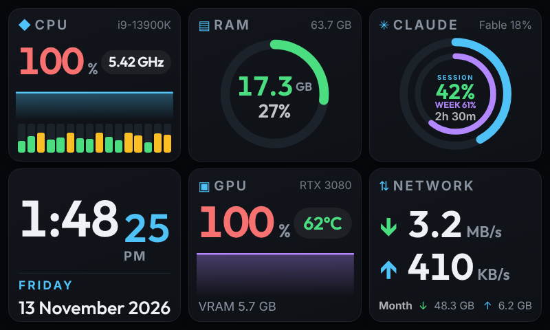
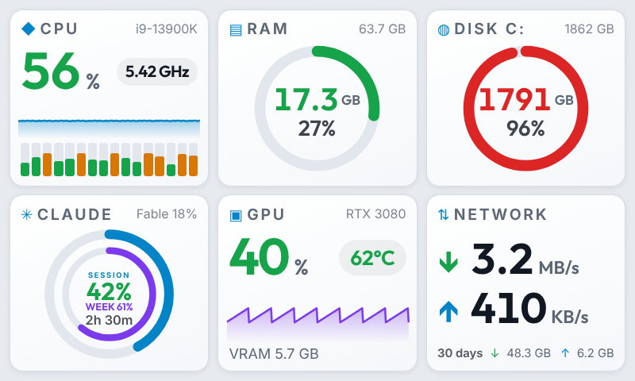
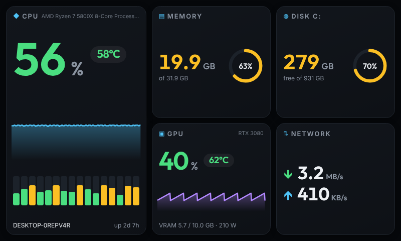
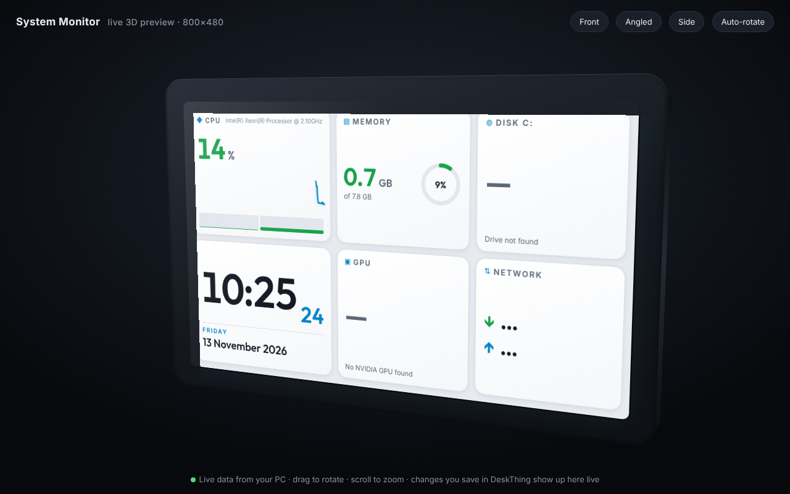

# System Monitor for DeskThing

A live PC dashboard for the Spotify Car Thing running [DeskThing](https://deskthing.app). Made by **CutSmokey**.



## Features

- **Six tiles you can rearrange.** The left side holds two tiles (or one large CPU panel) and the right side is a 2×2 grid. Each slot can show any tile.
- **Tiles:**
  - CPU: load, temperature, 1-minute graph and per-core bars
  - Clock and date, with seconds
  - RAM
  - Any disk on your PC
  - GPU: load, temperature, VRAM and power
  - GPU memory
  - CPU temperature
  - Network up and down
  - Fans
  - CPU power and clock
  - Uptime and PC name
- **Themes:** dark, light, or auto (light by day and dark by night, at hours you choose).
- **Sizing:** separate sliders for text size, number size and graph size, plus an accent colour.
- **Refresh rate:** from 0.25 s up to 5 s.
- **3D preview:** a live 3D view of the dashboard in your browser at `http://localhost:8893/`. To open it, turn on *Open the 3D Car Thing preview after saving* in the app settings and press Save.

| Light theme | One large CPU panel |
| --- | --- |
|  |  |



## Install

**From DeskThing**
1. Open **Downloads**, then click the **+** tile (Add a Release).
2. Paste this repository's URL: `https://github.com/mohdbushnaq/deskthing-system-monitor`
3. Download it, then click **Initialize App**.

New versions then show up behind DeskThing's **Update** button.

**From a file**
1. Download `sysmon-vX.Y.Z.zip` from [Releases](https://github.com/mohdbushnaq/deskthing-system-monitor/releases/latest).
2. In DeskThing, go to **Add App**, load the zip from file, then click **Initialize App**.

## CPU temperature, fans and power

Windows only exposes a rough motherboard thermal zone. For the real CPU package temperature, fan speeds and CPU power:

1. Install [LibreHardwareMonitor](https://github.com/LibreHardwareMonitor/LibreHardwareMonitor) and run it as administrator.
2. Turn on **Options → Remote Web Server** (port 8085).
3. Leave **CPU temperature source** on *Auto*.

GPU readings use NVIDIA's `nvidia-smi`, so other GPUs show "No NVIDIA GPU found".

## Build

```bash
npm install
npm run build   # writes dist/sysmon-vX.Y.Z.zip and dist/latest.json
```

To release: bump `version` in `deskthing/manifest.json` and `package.json`, then push to `main`. GitHub Actions builds the app and publishes release `vX.Y.Z` with the zip and `latest.json`, which DeskThing uses for its Update button.

## Contributors

- **CutSmokey**: author
- **Mohammed Bushnaq** ([@mohdbushnaq](https://github.com/mohdbushnaq)): contributor

## License

MIT © CutSmokey
